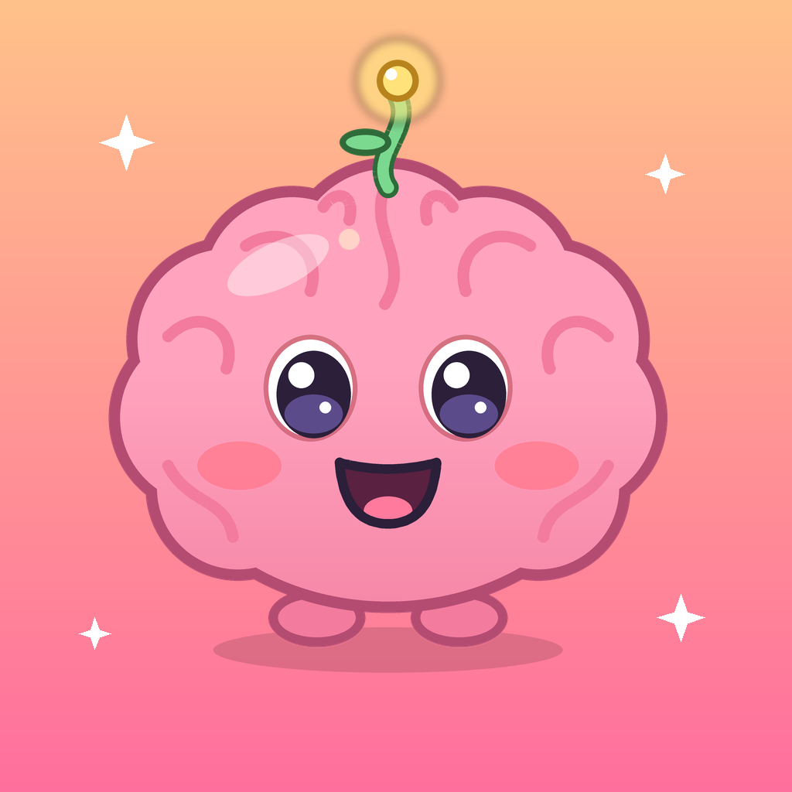

# RotTime

A playful iOS screen-time companion. **Noodle**, an original animated brain mascot, helps you focus,
shields distracting apps through Apple's real Screen Time frameworks, chats with you, and earns
themes and outfits as you build better habits.

<p align="center"></p>

## Features

| Area | What's there |
|------|--------------|
| **Mascot** | Procedurally drawn vector brain ("Noodle") with a spark-sprout antenna. 11 expressions (idle, happy, sleeping, surprised, tired, focused, celebrating, love, thinking, wink, proud) that blend with a masking blink; breathing, blinking, bouncing, arm waves, Zzz's, confetti. Tap to poke. |
| **Brain states** | Energetic · A little sleepy · Resting · Fully recharged — derived only from data RotTime measures (focus minutes vs goal, shields resisted, time of day). No diagnoses, no shaming. |
| **Home** | Animated mascot + speech bubble, status, today's goal ring, Quick Start Focus, shields status, quick actions, next reward, Apple's Screen Time report. |
| **Brain Chat** | Local, offline conversation engine (30 intents, contextual replies using your real progress), typing indicator, quick replies, action buttons, daily check-in events, reactions to finished sessions and resisted shields, persisted history. `BrainResponder` protocol ready for a future AI provider. |
| **Screen Time** | `AuthorizationCenter` (individual), `FamilyActivityPicker`, apps + categories + websites, named `ManagedSettingsStore`s, `DeviceActivity` schedules, usage-threshold daily limits. |
| **Extensions** | DeviceActivityMonitor (starts/ends schedules, limits and focus shields while the app is closed) · ShieldConfiguration (custom themed shield with the mascot and reflection prompts) · ShieldAction (“I'll stay focused” / two-step mindful pause → temporary unlock that re-locks itself) · DeviceActivityReport (real usage totals, rendered privately by Apple). |
| **Blocking modes** | Instant, Scheduled, Focus, Study, Sleep, Custom (+ add your own): apps, sites, start/end, weekdays, session & break length, strict mode, daily limit. Persisted locally. |
| **Focus timer** | 25 Pomodoro / 50 Deep / 15 Sprint / custom 5–180 min, 5/10/15 min breaks, pause/resume (unless strict), auto-break, celebration screen. Date-based + local notification + DeviceActivity end, so it's correct after backgrounding or termination. |
| **Themes** | Cozy Room, Space, Ocean, Forest, Candy World, Neon City, Dream World, Sunset, Winter, Minimal — each with original illustrated artwork, accents and ambient animation; 7 unlock by milestones. |
| **Customization** | 8 colours, 8 hats, 6 accessories, 6 effects, 6 decorations, 4 personalities, animation gallery. |
| **Progress** | Swift Charts week/month focus bars with goal line and selection, 30-day heatmap, sessions, block sessions, shields resisted, streaks, personal daily/weekly goals. |
| **Rewards** | 12 achievements, spark points, item/theme unlocks — earned only through activity. No purchases, loot boxes or randomness. |

## Project layout

```
RotTime/App              App entry, root navigation
RotTime/Features/        Home, BrainChat, Focus, AppBlocking, Statistics, Customization, Rewards, Settings, Onboarding
RotTime/Core/            CharacterEngine, ThemeManager, ScreenTime, Storage, Notifications, Rewards, DesignSystem
Shared/                  Code compiled into the app AND the extensions (models, shields, scheduling, shield copy)
Extensions/              DeviceActivityMonitor, ShieldConfiguration, ShieldAction, ActivityReport
RotTimeTests/            Unit tests
project.yml              XcodeGen spec (the .xcodeproj is generated)
tools/render_mascot.py   Renders the app icon + shield icon from the mascot geometry
.github/workflows/       macOS CI: build, validate, test, sign, export
```

## Building

No Mac needed — see **[docs/SIGNING.md](docs/SIGNING.md)** for the GitHub Actions setup, the secrets
to add, and Apple's Family Controls entitlement requirements.

With a Mac: `brew install xcodegen && xcodegen generate && open RotTime.xcodeproj`, set your team
and `RT_BUNDLE_ID` / `RT_APP_GROUP` build settings, and run on a real device (Screen Time APIs
don't shield apps in the simulator).

## Privacy

Everything is stored on-device in the App Group container. Apple only gives RotTime opaque tokens
for the apps you choose; screen-time totals are drawn by Apple's report extension and never
reach the app. No servers, analytics or ads.

## Known platform limits

* The Family Controls entitlement is required for any blocking; App Store/TestFlight distribution needs Apple's approval.
* DeviceActivity intervals must be ≥ 15 minutes; shorter focus sessions use an interval that starts in the past so it still ends on time.
* Apple caps individually shielded apps at 50 per store; categories have no such limit.
* Shield screens are rendered by iOS from `ShieldConfiguration` — they can show an image, text and two buttons, not custom animation.
